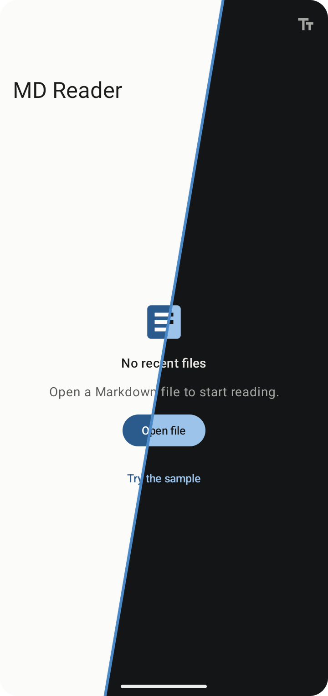
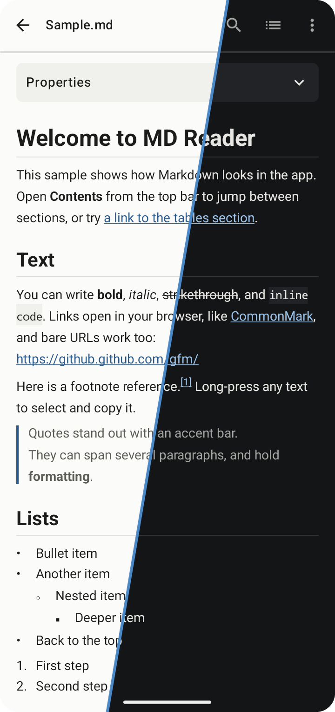
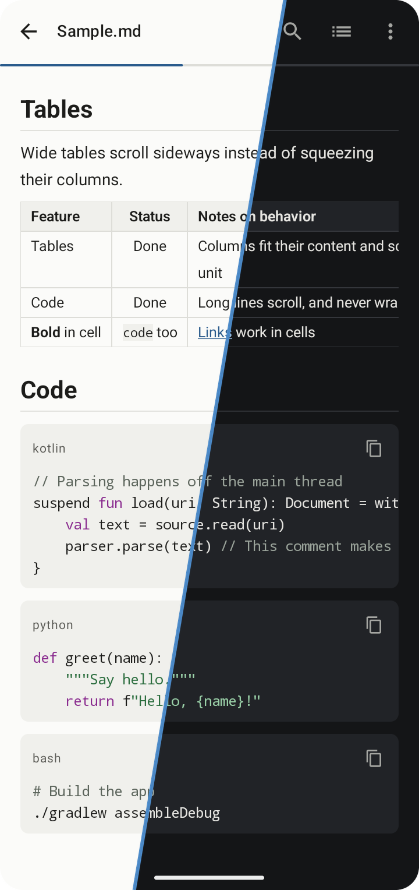
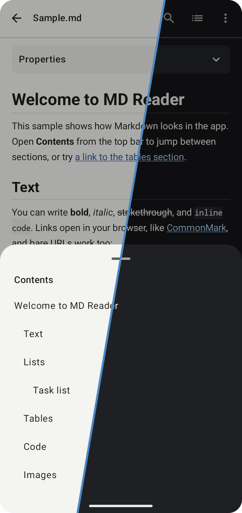
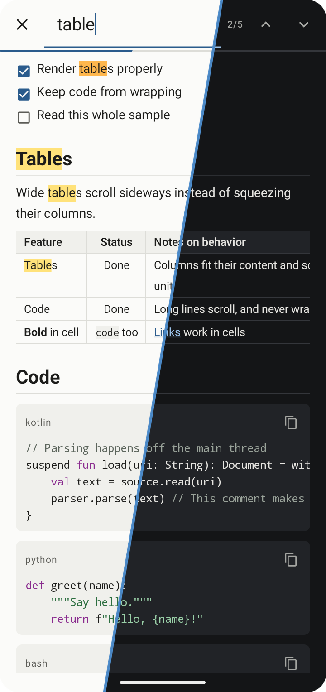
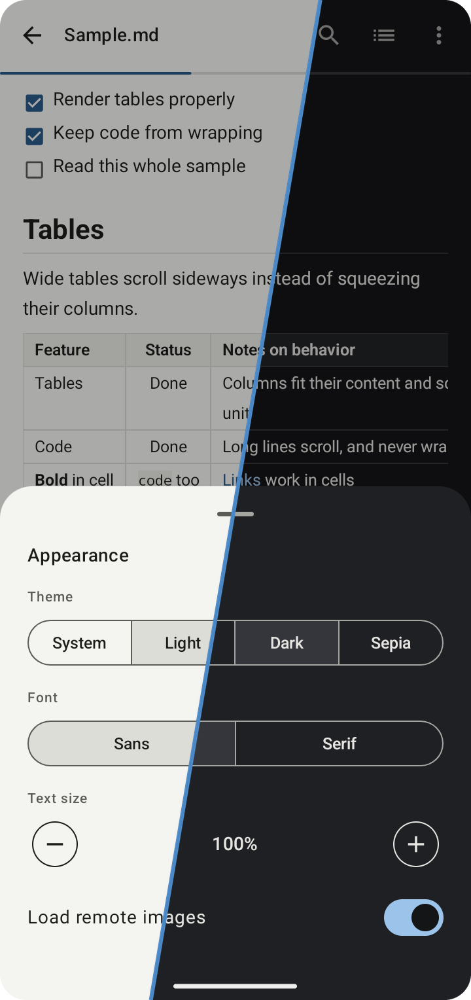

<p align="center">
  
</p>

<h1 align="center">MD Reader</h1>

An Android app for reading Markdown files properly: tables stay tables, code doesn't reflow, and files open from anywhere.

Android has no built-in Markdown viewer, so `.md` files usually open as plain text full of `#` and `|` characters, if they open at all. This app shows them the way they were meant to be read, with no account or storage permission.

<table>
  <tr>
    <td align="center" width="33%"><br><sub>Home screen</sub></td>
    <td align="center" width="33%"><br><sub>Formatted reading view</sub></td>
    <td align="center" width="33%"><br><sub>Tables and code</sub></td>
  </tr>
  <tr>
    <td align="center" width="33%"><br><sub>Table of contents</sub></td>
    <td align="center" width="33%"><br><sub>Find in document</sub></td>
    <td align="center" width="33%"><br><sub>Appearance settings</sub></td>
  </tr>
</table>

Each image shows the light theme on the left and the dark theme on the right. Full versions are in [`light`](docs/screenshots/light) and [`dark`](docs/screenshots/dark). All of them show the sample document included in the app.

## Features

- **Opens files from anywhere:** use the system file picker, **Open with** in a file manager, or **Share** from another app. `.md` files are matched by extension, so they still open when another app reports the wrong file type.
- **Full Markdown support:** CommonMark and GitHub Flavored Markdown, plus footnotes and YAML front matter.
- **Tables and code that keep their shape:** wide tables and long code lines scroll sideways instead of wrapping.
- **Handles awkward files:** reads UTF-8, UTF-16 and Windows-1252, and copes with byte order marks and Windows line endings. Binary files get a clear message instead of garbage.
- **Easy to navigate:** a table of contents, find in document, and links that jump to a section.
- **Raw source view:** switch between the formatted document and the original text.
- **Comfortable reading:** System, Light, Dark and Sepia themes, sans or serif font, and text size from 80% to 160%.
- **Recent files:** reopen a file where you left off.
- **Code tools:** syntax highlighting for common languages and a copy button on each code block.
- **Select and share:** select text to copy it, or share the file.

## How to use

1. Open the app, then tap **Open file** and choose a Markdown file. To look around first, tap **Try the sample**.
2. Or open a file from another app:
   - In a file manager, tap a `.md` file and choose **MD Reader**.
   - In another app, share a Markdown file to **MD Reader**.
3. While reading, use the top bar:
   - **Search icon:** find text in the document.
   - **List icon:** open the table of contents.
   - **Menu:** view the source, change the appearance, or share the file.

### Supported Markdown

| Element | How it appears |
| --- | --- |
| Headings, bold, italic, strikethrough | Formatted, with headings listed in the table of contents |
| Tables | Bordered grid with column alignment; scrolls sideways |
| Fenced code | Card with a language label and copy button; scrolls sideways |
| Task lists | Checked and unchecked boxes (read-only) |
| Links | Web and email links open outside the app; `#section` links jump within the document |
| Images | Loaded from `https` links, including SVG badges |
| Footnotes | Collected at the end of the document, with tappable references |
| YAML front matter | Collapsed **Properties** card |
| Embedded HTML | `<br>` and `` are used; other tags are reduced to their text |

## Installation

**[Download the latest APK](https://github.com/chaitanyakelkar/mdfilereader-android-app/releases/latest/download/MDReader.apk)** for Android 7.0 or newer. Older versions are on the [releases page](https://github.com/chaitanyakelkar/mdfilereader-android-app/releases).

1. Download the APK on your phone and open it.
2. If asked, allow your browser or file manager to install unknown apps. Google Play Protect may show a warning because the app isn't from the Play Store.
3. Open **MD Reader**.

To update, download the newest APK and install it over the old one. The app doesn't update itself.

### Build from source

**Requirements**

- Android Studio, or the Android SDK with API level 37 and JDK 17 or newer
- A device or emulator running Android 7.0 (API 24) or newer

**From Android Studio:** open the project, choose your device and press **Run**.

**From the command line:**

```bash
git clone https://github.com/chaitanyakelkar/mdfilereader-android-app.git
cd mdfilereader-android-app
./gradlew installDebug
```

On Windows, use `gradlew.bat installDebug`.

To run the unit tests:

```bash
./gradlew testDebugUnitTest
```

To run the instrumented tests, with a device or emulator connected:

```bash
./gradlew connectedDebugAndroidTest
```

Without a signing key, `assembleRelease` produces an unsigned APK, which Android won't install. To set up a key and publish a release, see the [release guide](docs/05-releasing.md).

## Privacy

- The app has no analytics or accounts, and asks you for no storage permission. It can only read files you open with it.
- Your settings and recent files list are stored on the device, and are excluded from Android's app backup.
- The only network use is loading remote images in a document. This reveals your IP address to the image's host, as in any browser. You can turn it off under **Appearance > Load remote images**.

## Security

Documents are treated as untrusted:

- The app doesn't use a WebView, and scripts in a document never run.
- Only `http`, `https` and `mailto` links open. Others, such as `javascript:` and `file:`, are blocked.
- Images load only from the web, so a document can't read your local files by path.

## Limitations

- Images and links that point to files next to your document don't work, because Android only grants access to the file you opened. Images show a placeholder and links show a message.
- Mermaid diagrams and LaTeX math appear as code.
- Files larger than 10 MB can't be opened.
- A file opened from another app may need opening again after a restart, depending on what that app allows. Files chosen with **Open file** stay available unless their provider doesn't allow it.
- The app views files and doesn't edit them.
- So far it has been tested on Android 13 only, including a Nokia C32. Older versions are supported in the build but haven't been tested.

## Project structure

```text
app/src/main/java/io/github/chaitanyakelkar/mdreader/
├── MainActivity.kt   File picker, Open with and Share handling
├── AppRoot.kt        Navigation and app state
├── data/             File loading, encoding detection, settings, recent files
├── markdown/         Parser, document model, search, highlighter, link rules
└── ui/               Home and reader screens, Markdown rendering, themes
app/src/test/         Unit tests
app/src/androidTest/  Instrumented tests
```

## Project documents

1. [Requirements](docs/01-requirements.md)
2. [UI design](docs/02-ui-design.md) and [mockups](docs/design/ui-mockups.html)
3. [Architecture](docs/03-architecture.md)
4. [Test report](docs/04-test-report.md)
5. [Release guide](docs/05-releasing.md)

## Built with

- [Kotlin](https://kotlinlang.org/) and [Jetpack Compose](https://developer.android.com/compose) with Material 3
- [commonmark-java](https://github.com/commonmark/commonmark-java) for Markdown parsing
- [Coil](https://github.com/coil-kt/coil) for remote images and SVG badges
- [Jetpack DataStore](https://developer.android.com/topic/libraries/architecture/datastore) for settings and recent files

## License

Released under the [MIT License](LICENSE).
